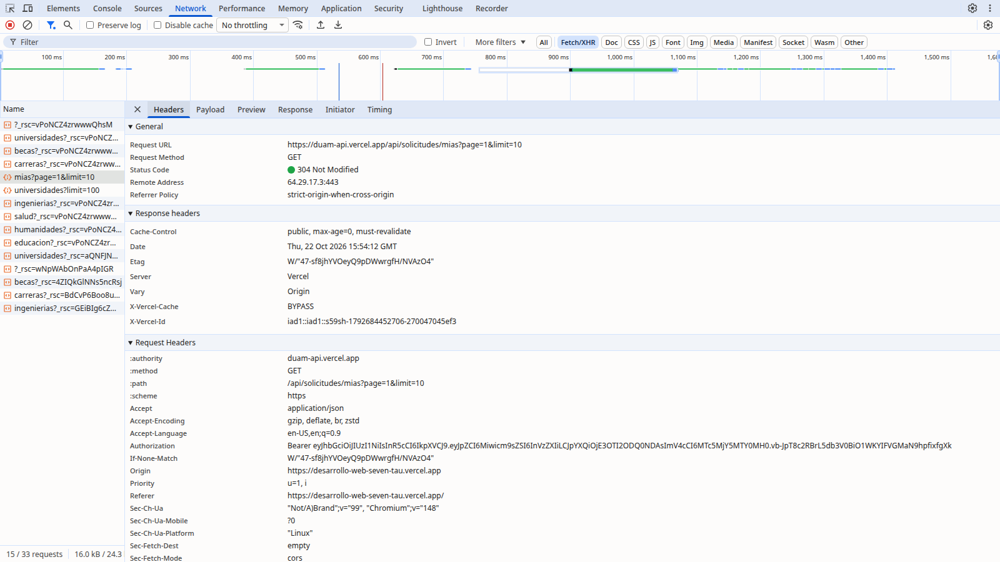

# DUAM — Directorio Universitario del Área Metropolitana

DUAM reúne en un solo lugar la oferta de educación superior del Área Metropolitana del Valle de Aburrá (Antioquia): universidades privadas y oficiales, carreras por área de estudio y opciones de financiación. Permite buscar, filtrar, comparar universidades lado a lado y, con una cuenta, enviar solicitudes PQRS (petición, queja, reclamo o sugerencia) sobre una universidad y seguir su estado. Un panel de administración gestiona los catálogos y las solicitudes.

| | URL |
|---|---|
| Frontend (Vercel) | **https://desarrollo-web-seven-tau.vercel.app** |
| API (Vercel) | **https://duam-api.vercel.app/api** (p. ej. [`/api/universidades`](https://duam-api.vercel.app/api/universidades)) |

## Estructura del repositorio

```
DUAM2/
├── backend/    API REST: Node.js + Express 5 + TypeScript + Prisma 7 + PostgreSQL (Neon) — ver backend/README.md
├── frontend/   Next.js 16 (App Router) + TypeScript + Tailwind v4, organizado por features — ver frontend/README.md
├── legacy/     sitio estático original (Entrega 1), referencia visual
├── docs/       CHECKLIST.md (estado contra la guía de la entrega), PLAN.md, img/
├── DESIGN.md   sistema visual (tokens, componentes, reglas)
└── PRODUCT.md  contexto de producto
```

> **Monorepo (decisión del equipo).** La guía pide un repositorio por proyecto; aquí `backend/` y `frontend/` son proyectos independientes (cada uno con su `package.json`, README, variables y proyecto de Vercel) dentro del mismo repositorio. Ver `docs/CHECKLIST.md` (choques C1–C7).

## Correr en local

Requisitos: Node.js ≥ 20 y PostgreSQL (o podman/docker).

```bash
# 1. Base de datos (puerto 5433 para no chocar con un Postgres instalado)
podman run -d --name duam-pg -e POSTGRES_USER=duam -e POSTGRES_PASSWORD=duam -e POSTGRES_DB=duam -p 5433:5432 postgres:17-alpine

# 2. API → http://localhost:4000/api
cd backend
cp .env.example .env            # y pon un JWT_SECRET propio
npm install                     # genera el cliente de Prisma
npm run db:migrate              # aplica las migraciones
npm run db:seed                 # catálogo de la Entrega 1 + usuarios de prueba
npm run dev

# 3. Frontend → http://localhost:3000 (en otra terminal)
cd frontend
cp .env.example .env.local      # NEXT_PUBLIC_API_HOST=http://localhost:4000
npm install
npm run dev
```

Pruebas: `cd backend && npm test` (23 pruebas de la API contra Postgres real) y `cd frontend && npm run test:e2e` (27 pruebas en navegador, con el sitio y la API corriendo).

### Variables de entorno

| Proyecto | Variable | Para qué |
|---|---|---|
| backend | `DATABASE_URL` | Conexión a PostgreSQL (en Neon, la *pooled*) |
| backend | `DATABASE_URL_UNPOOLED` | (Opcional) conexión directa para migraciones y seed en Neon |
| backend | `JWT_SECRET` | Clave para firmar los JWT (mínimo 32 caracteres; sin ella la API no arranca) |
| backend | `JWT_EXPIRES_IN` | Duración del token (`2h`) |
| backend | `CORS_ORIGINS` | URL(s) del frontend permitidas por CORS, separadas por coma (nunca `*`) |
| backend | `PORT` | Puerto local (4000) |
| frontend | `NEXT_PUBLIC_API_HOST` | URL de la API sin `/api` (local `http://localhost:4000`, producción `https://duam-api.vercel.app`) |

Los `.env` reales están en `.gitignore`; en producción las variables viven en cada proyecto de Vercel.

## Credenciales de prueba

Creadas por `npm run db:seed`. **Solo para el ambiente de la entrega.**

| Rol | Correo | Contraseña |
|---|---|---|
| admin | `admin@duam.co` | `AdminDuam2026!` |
| user | `usuario@duam.co` | `UsuarioDuam2026!` |

## Funcionalidades

- **Catálogos** (públicos, desde la API, paginados por URL `?page=` con estados de cargando / vacío / error): universidades (con filtros `?tipo=` y búsqueda sin tildes `?q=`) y áreas de estudio con sus programas. Becas y buscador global.
- **Cuentas**: registro, login, sesión persistente, logout. La barra de navegación cambia según la sesión (invitado: "Ingresar"; usuario: su nombre y "Salir"; admin: además "Administración").
- **Solicitudes PQRS** (la interacción usuario ↔ catálogo): el formulario de ayuda de la Entrega 1 ahora crea una solicitud sobre una universidad, a nombre del usuario en sesión. `/mis-solicitudes` muestra las propias con su estado.
- **Administración** (`/admin`, solo rol admin): todas las solicitudes con cambio de estado, CRUD de universidades y de áreas de estudio.
- Favoritos y comparación de universidades (en el navegador), modo claro/oscuro, diseño responsive.

## Decisiones técnicas

> Explicación de cómo está construido el proyecto, con ejemplos reales del código. La sección sobre IA es un **borrador** y los autores deben revisarla y escribirla con sus palabras antes de la entrega.

### Flujo completo de un login

1. **Formulario** (`frontend/src/features/auth/components/LoginForm.tsx`): valida en el cliente que el correo tenga formato válido y que la contraseña no esté vacía. Si hay errores, se muestran debajo de cada campo y no se envía nada.
2. **Hook y servicio**: `useAuth().login()` llama a `authService.login()` (`features/auth/services/auth.service.ts`), que usa el cliente HTTP único `features/common/http.ts` para hacer `POST https://duam-api.vercel.app/api/auth/login` con `{ email, password }`.
3. **API**: el router (`backend/src/interface/http/routes/index.ts`) pasa la petición al controlador, que valida el body con zod (400 si es inválido) y llama al caso de uso `login` (`backend/src/application/auth.ts`). Este busca el usuario por email con Prisma y compara la contraseña con el hash usando **bcrypt**. Si el email no existe, igual compara contra un hash de relleno, para que el tiempo de respuesta no delate qué cuentas existen. Si algo falla, responde **401 "Correo o contraseña incorrectos"**, el mismo mensaje en ambos casos.
4. **Token**: si las credenciales son válidas, `jwtTokenService.sign()` firma un JWT HS256 con `JWT_SECRET` y `expiresIn = JWT_EXPIRES_IN` (2h). El payload solo lleva `{ id, role }`. La respuesta es `{ token, user }`, donde `user` nunca incluye la contraseña.
5. **Sesión en el navegador**: `sessionStore.set()` guarda `{ token, user }` en `localStorage`. La barra de navegación se actualiza (nombre, "Salir", "Administración" si es admin) y el usuario vuelve a la página de `?next=`.
6. **Ruta protegida**: al abrir `/mis-solicitudes`, `RequireAuth` deja pasar porque hay sesión, y `useMyRequests()` llama a `requestsService.mine()`. `http.ts` agrega `Authorization: Bearer <token>`.
7. **En la API**, el router de `/api/solicitudes` aplica `authenticate`: lee el header, verifica firma y expiración con `JWT_SECRET` y deja `req.user = { id, role }`. El controlador lista solo las solicitudes con `userId = req.user.id` (nunca un id que venga del cliente) y responde `{ pagination, data }`.



*Captura de la pestaña Network de Chromium en producción: la petición protegida lleva `Authorization: Bearer <jwt>` (token de la cuenta de prueba, ya vencido). Se puede regenerar con `node frontend/e2e/network-screenshot.mjs docs/img`.*

### ¿Dónde se guarda el token y qué riesgo tiene?

En **`localStorage`** (clave `duam-session`, junto al usuario público). Se eligió porque es simple, sobrevive al recargar y permite que `http.ts` agregue el header `Authorization` a cualquier petición hacia una API en otro dominio.

**Riesgo:** cualquier JavaScript que logre ejecutarse en la página, por ejemplo por XSS o por una dependencia comprometida, puede leer el token y usarlo hasta que expire. Lo mitigamos así:

- React escapa el contenido y no se usa `dangerouslySetInnerHTML` con datos de usuario (el único uso es el script fijo del tema).
- El token dura solo **2 horas**.
- El payload no lleva datos sensibles.
- El frontend descarta al cargar un token cuyo `exp` ya pasó.
- Ante cualquier 401, `http.ts` borra la sesión.

La alternativa más segura sería una cookie `HttpOnly; Secure; SameSite`, que JavaScript no puede leer. Con dos dominios distintos (frontend y API) eso exige configurar cookies entre sitios y protección CSRF, y queda como mejora.

### ¿Cuándo responde la API 401 y cuándo 403?

- **401 Unauthorized: no sabemos quién eres o tu identidad no es válida.** Pasa cuando no hay token, el header no es `Bearer`, la firma no coincide o el token expiró. También en un login con credenciales incorrectas. Ejemplo real: `GET /api/solicitudes/mias` sin header devuelve `401 {"error":"Se requiere iniciar sesión"}`, y con un token vencido `401 {"error":"Sesión inválida o expirada"}`. En el frontend, un 401 en una petición que llevaba token cierra la sesión y redirige a `/login`.
- **403 Forbidden: sabemos quién eres, pero no tienes permiso.** El token es válido pero el rol no alcanza (middleware `soloAdmin`). Ejemplo real: con la sesión de `usuario@duam.co`, `GET /api/solicitudes` (listar todas) o `POST /api/universidades` devuelven `403 {"error":"No tienes permiso para realizar esta acción"}`. En el frontend, si ese usuario escribe `/admin` en la URL, se le redirige al inicio; y aunque se saltara esa redirección, la API seguiría respondiendo 403.

### Uso de IA (borrador para que lo completen los autores)

Se usó un asistente de IA (Claude Code) como pareja de programación para:

- migrar el sitio estático a Next.js conservando los tokens de diseño;
- reescribir el backend con Prisma y la arquitectura de 4 capas;
- implementar la autenticación JWT;
- escribir las pruebas automáticas y desplegar en Vercel.

Correcciones hechas durante el proceso (a revisar y completar por el equipo):

- **Decisiones que el equipo cambió:** mantener el monorepo y la API en Vercel en lugar de separar repositorios y usar Render; eliminar la página "Nosotros"; definir como catálogos universidades **y** carreras.
- **Errores detectados con pruebas y capturas y corregidos:**
  - la búsqueda no encontraba "Medellín" al escribir "medellin";
  - el header se desbordaba a 1280 px con la sesión de admin;
  - una condición de carrera entre la redirección de `/login` y el guard de invitados;
  - pruebas que interactuaban antes de que la página estuviera lista.
- **Contenido a revisar:** el video de "ICETEX - Créditos y Becas" en los datos de la Entrega 1 no corresponde a ICETEX, y la afirmación "acreditadas de alta calidad" no está verificada para cada universidad.

*(Agreguen aquí, en sus palabras, para qué usaron la IA ustedes y qué tuvieron que corregir o decidir.)*

## Despliegue

| Proyecto Vercel | Root Directory | Variables | Se actualiza con |
|---|---|---|---|
| `desarrollo-web` (frontend) | `frontend` | `NEXT_PUBLIC_API_HOST` | push a `main` |
| `duam-api` (backend) | `backend` | `DATABASE_URL`/`DATABASE_URL_UNPOOLED` (integración Neon), `JWT_SECRET`, `JWT_EXPIRES_IN`, `CORS_ORIGINS` | push a `main` |

> **Desviación de la guía (decisión del equipo):** el backend está en Vercel (Express como función) y no en Render o Railway. Las migraciones de la base de producción se aplican manualmente con `npm run db:deploy` usando la URL directa de Neon.
